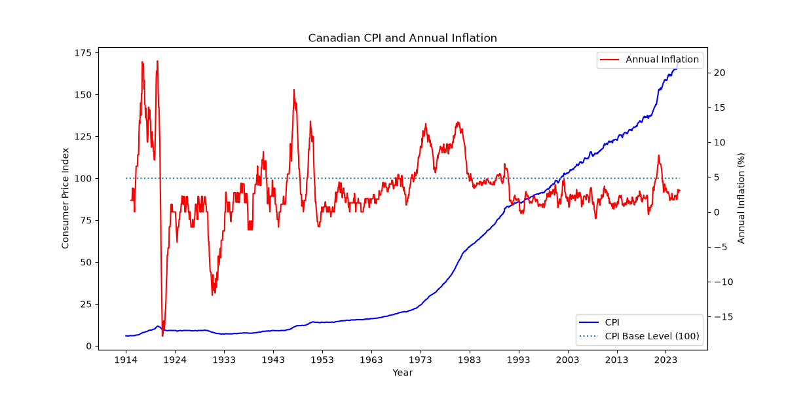
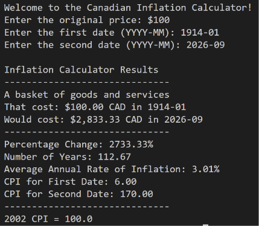

# FINE3300-2026-A2
FINE3300 Assignment 2: A Python-based Canadian Inflation Calculator that uses historical Consumer Price Index (CPI) data to analyze inflation trends and calculate changes in purchasing power between selected months and years.

# FINE3300 Assignment 2: Canadian CPI and Inflation Calculator

## Project Description
For this assignment, I created two Python programs using monthly Consumer Price Index (CPI) data from the Bank of Canada. The first program creates a graph showing the Canadian CPI and annual inflation over time. The second program is an inflation calculator that uses CPI data to find how much a price from one month and year would be worth in another month and year.

The calculator is based on the Bank of Canada's Inflation Calculator, but it allows users to enter a month and year instead of just a year.

## Part 1: Canadian CPI Graph
For the first part of the assignment, I used Pandas to read the CPI data from a CSV file. I then used Matplotlib to create a graph of the CPI and the annual percentage change in CPI. The CPI is shown on the left axis, and the annual inflation rate is shown on the right axis. I also added a dotted line at the CPI base level of 100.

### Graph Commentary
The graph shows that the Canadian CPI has generally increased over time, meaning that the overall price level has risen. The CPI increases more quickly during some periods than others. The annual inflation line shows these changes more clearly, including periods of higher inflation and periods when inflation was lower or negative. The dotted line marks the CPI base level of 100, with 2002 as the base year.

## Part 2: Inflation Calculator
For the second part of the assignment, I created a class called �InflationCalculator� that reads the CPI data from the CSV file. The program asks the user to enter an original price, a first date, and a second date. Dates must be entered in YYYY-MM format.

The program checks that the price is valid and that both dates are correctly formatted and available in the CPI data. It then uses the CPI values for the selected months to calculate the adjusted price, percentage change, number of years between the dates, and average annual inflation rate.

### Sample Calculator Output
The following shows the format of the calculator's results.

## Files
- CpiGraph.ipynb - Python program that creates the CPI and annual inflation graph
- InflationCalculator.py - Python program that calculates inflation between two months
- STATIC_INFLATIONCALC.csv - CSV file containing the monthly CPI data
- CpiGraph.png - Graph created by the CPI graph program
- InflationCalculatorOutput.png - Output from the inflation calculator
- README.md - An overview of the project, graph, calculator, and instructions

## How to Run the Programs
1. Open the assignment folder in Visual Studio Code
2. Make sure Python is installed
3. Install Pandas and Matplotlib if they are not already installed:

    a. pip install pandas
    b. pip install matplotlib
    
4. Keep STATIC_INFLATIONCALC.csv in the same folder as the Python files
5. Run CpiGraph.ipynb to display the CPI graph and to save it as CpiGraph.png
6. Run InflationCalculator.py to open the inflation calculator
7. Enter the original price and the two dates in YYYY-MM format when prompted
8. View the inflation-adjusted price and the other results displayed by the program
